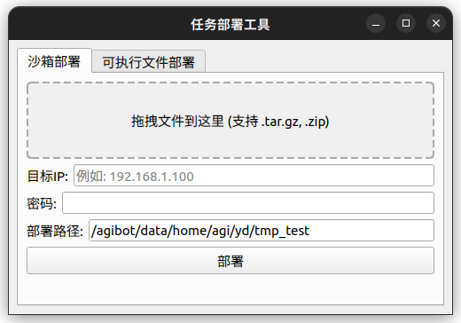

# A2-W develop record

下载的 `aima_task_sdk_example` 的文件结构如下：

```
./aima_task_sdk_example/
├── artifacts
│   ├── release_agi_task_sdk_v0.6.0-rc5_aarch64.zip
│   └── release_agi_task_sdk_v0.6.0-rc5_x86.zip
├── build.sh
├── cmake
│   ├── download_te.cmake
│   └── make_te_available.cmake
├── CMakeLists.txt
├── doc
│   ├── build.sh
│   ├── cn
│   │   ├── actions
│   │   ├── _build
│   │   ├── conf.py
│   │   ├── deploy
│   │   ├── example
│   │   ├── faq
│   │   ├── getting_started
│   │   ├── index.md
│   │   ├── interface
│   │   ├── operation
│   │   ├── _static
│   │   └── _templates
│   ├── conf.py
│   ├── icon.jpg
│   ├── install-deps.sh
│   ├── README.md
│   └── run.sh
├── example
│   ├── CMakeLists.txt
│   ├── decorator_task
│   │   ├── CMakeLists.txt
│   │   ├── task.cpp
│   │   └── task.h
│   ├── main.cpp
│   ├── mc_task
│   │   ├── CMakeLists.txt
│   │   ├── rand_joint_control.cpp
│   │   ├── rand_joint_control.h
│   │   ├── task.cpp
│   │   └── task.h
│   ├── perception_task
│   │   ├── CMakeLists.txt
│   │   ├── task.cpp
│   │   └── task.h
│   ├── pnc_task
│   │   ├── CMakeLists.txt
│   │   ├── task.cpp
│   │   └── task.h
│   └── purui_task
│       ├── CMakeLists.txt
│       ├── task.cpp
│       └── task.h
├── README.md
└── tools
    ├── get_joint_angle.sh
    ├── get_robot_tcp_arm.sh
    ├── get_robot_tcp_cam.sh
    ├── TaskConig_example_PuRuiTask.yaml
    ├── te_task_deployer.py
    └── te_worker_debugger.py

```

**目前可用示例Task：**

+ `mc_task` ： 调用运控控制机器人的任务示例
+ `perception_task` ： 调用感知控制机器人的任务示例

+ `pnc_task` ： 调用 PNC 控制机器人的任务示例

+ `purui_task`： 下料任务示例

+ `decorator_task`： 多种装饰器使用示例

与文档内给出的文件结构有出入，缺少 `scenario` , `src` , `task`文档内结构如下：

```bash
scenario ------------------------------- // 基于场景的任务开发 （需要内网权限）
├── junsheng ------------------------------- // 均胜 POC 场景 
├── test_pressing -------------------------- // 应力测试场景 
│
│
example ------------------------------- // 示例代码
├── action ------------------------------- // 本体行为开发示例（二开伙伴暂时无需关注）
├── task --------------------------------- // 任务开发示例
│   ├── mc -------------------------------- // 调用运控控制机器人的任务示例
│   └── pnc -------------------------------- // 调用 PNC 控制机器人的任务示例
│   └── perception ------------------------- // 调用感知控制机器人的任务示例
│   └── decorator_test --------------------- // 多种装饰器使用示例
│
src
├── action --------------------------------- // 机器人行为单元集合
│   ├── 2d_object_detection ---------------- // 2D 目标检测
│   └── 6d_object_detection ---------------- // 6D 目标检测
│   └── arm ---------------------------------- // 具身任务控制（with EI Skill）
│   └── mc ---------------------------------- // 运控
│   └── pnc ---------------------------------- // PNC
│   └── plc ---------------------------------- // PLC 
│
├── task ----------------------------------- // 任务编程框架基建源码目录
│   ├── interface -------------------------- // 任务开发接口
│   │   ├── all_in_one ------------------------ // 一站式任务开发依赖
│   │   └── i_task ---------------------------- // 任务统一开发接口
│   │   └── i_action -------------------------- // 本体行为开发接口 （二开伙伴暂时无需关注）
│   │   └── decorator ------------------------- // 装饰器
│   │   └── app -------------------------------- // 任务执行入口
│   │   └── reader ---------------------------- // Action 的话题订阅插件 （二开伙伴暂时无需关注）
│   │   └── proxy set -------------------------- // Action 开发接入 rpc 资源 （二开伙伴暂时无需关注）
│   │
│   └── utils ------------------------------ // 任务调试工具集合（CLI 工具）
│       
│

```


首次运行 `.bash.sh` 提示错误：

```bash
aima_task_sdk_example/agi_task_sdk/install/include/aimrte/./convert/interface.h: In function ‘void aimrte::impl::Convert(const TFrom&, TTo&)’:
aima_task_sdk_example/agi_task_sdk/install/include/aimrte/./convert/interface.h:22:3: error: static assertion failed: R"(
You forget to implement Convert() function for your types.

// such as
namespace aimrte::impl
{
  template <>
  void Convert(const YourOriginalType & src, YourTargetType & dst) {
    // ... some convertion
  }
}
)"
   22 |   AIMRTE_STATIC_PANIC(
      |   ^~~~~~~~~~~~~~~~~~~
```

```bash
aima_task_sdk_example/agi_task_sdk/install/include/aimrte/./convert/interface.h:176:17: error: static assertion failed: "Unsupported type, you should define a converted type for it:
// such as:
namespace aimrte::convert
{
  template <>
  struct For<YourType> : By<YourAnotherType> {};
}
"
  176 |   static_assert(false, R"("Unsupported type, you should define a converted type for it:
      |                 ^~~~~

```

需要在 `aima_task_sdk_example/agi_task_sdk/install/include/aimrte/./convert/interface.h` 中对两个接口进行用户定义：

```C++
namespace aimrte::impl
{
/**
 * @brief 类型转换统一接口，需要由特定类型特化实现
 * @tparam TFrom 原始类型
 * @tparam TTo   目标类型
 * @param src 原始类型的对象
 * @param dst 目标类型的对象
 */
template <class TFrom, class TTo>
void Convert(const TFrom& src, TTo& dst)
{
  AIMRTE_STATIC_PANIC(
    R"(
You forget to implement Convert() function for your types.

// such as
namespace aimrte::impl
{
  template <>
  void Convert(const YourOriginalType & src, YourTargetType & dst) {
    // ... some convertion
  }
}
)");
}
```

```c++
 * @brief 定义一个类型的转换类型，需要用户使用特化去定义它的转换类型
 * @tparam TOriginal 原始类型
 * @code
 *   namespace aimrte::convert {
 *     template <>
 *     struct For<int> : By<double> {};
 *   }
 *
 *   template <class T>
 *   void foo() {
 *     // 一般会在框架中被使用：
 *     using Type = aimrte::convert::For<T>::AnotherType;
 *   }
 * @endcode
 */
template <class TOriginal>
struct For {
#if __GNUC__ > 11
  static_assert(false, R"("Unsupported type, you should define a converted type for it:
// such as:
namespace aimrte::convert
{
  template <>
  struct For<YourType> : By<YourAnotherType> {};
}
")");
#endif
};
}  // namespace aimrte::convert
```


`CMakeLists.txt` 中会对 `aima_task_sdk` 进行重装，需要取消相关操作，否则重定义会被覆盖

```cmake
# 下载 task sdk
include(cmake/download_te.cmake)
```

```cmake
message(STATUS "Downloading agi_task_sdk ...")

# 检测平台架构
if(CMAKE_SYSTEM_PROCESSOR MATCHES "aarch64|arm64|ARM64")
    set(PLATFORM_SUFFIX "arm64")
    message(STATUS "Detected ARM64 platform")
    set(SDK_FILENAME "release_agi_task_sdk_v0.6.0-rc5_aarch64.zip")
    set(SDK_URL "https://file.agibot.com/agi_task_sdk/${SDK_FILENAME}")
elseif(CMAKE_SYSTEM_PROCESSOR MATCHES "x86_64|amd64|AMD64")
    set(PLATFORM_SUFFIX "x86_64") 
    message(STATUS "Detected x86_64 platform")
    # 下载 ZIP 包
    set(SDK_FILENAME "release_agi_task_sdk_v0.6.0-rc5_x86.zip")
    set(SDK_URL "https://file.agibot.com/agi_task_sdk/${SDK_FILENAME}")
else()
    message(FATAL_ERROR "Unsupported platform: ${CMAKE_SYSTEM_PROCESSOR}")
endif()

if(NOT EXISTS "${CMAKE_SOURCE_DIR}/artifacts/${SDK_FILENAME}")
    file(DOWNLOAD "${SDK_URL}"
        "${CMAKE_SOURCE_DIR}/artifacts/${SDK_FILENAME}"
        STATUS download_status
        SHOW_PROGRESS
    )

    # 检查下载状态
    if(NOT download_status EQUAL 0)
        message(FATAL_ERROR "Failed to download agi_task_sdk")
    endif()
else()
    message(STATUS "${CMAKE_SOURCE_DIR}/artifacts/${SDK_FILENAME} already downloaded, skipping download.")
endif()

# 解压 ZIP 包
file(ARCHIVE_EXTRACT
    INPUT "${CMAKE_SOURCE_DIR}/artifacts/${SDK_FILENAME}"
    DESTINATION "${CMAKE_SOURCE_DIR}/agi_task_sdk"
)

```

对相关部分进行处理后，运行 `bash.sh` 可以得到 `task_sandbox.zip`

```bash
  adding: task_sandbox/cmake/GetPybind11.cmake (deflated 46%)
  adding: task_sandbox/cmake/NamespaceTool.cmake (deflated 64%)
  adding: task_sandbox/cmake/PluginDetectTool.cmake (deflated 41%)
  adding: task_sandbox/cmake/GetGFlags.cmake (deflated 50%)
  adding: task_sandbox/cmake/GetFmt.cmake (deflated 41%)
  adding: task_sandbox/cmake/GetBoost.cmake (deflated 44%)
  adding: task_sandbox/cmake/Ros2AimRTRpcGenCode.cmake (deflated 57%)
  adding: task_sandbox/cmake/GetIceoryx.cmake (deflated 46%)
  adding: task_sandbox/cmake/GetProtobuf.cmake (deflated 53%)
  adding: task_sandbox/cmake/GetJsonCpp.cmake (deflated 55%)
  adding: task_sandbox/cmake/GetLibUnifex.cmake (deflated 45%)
  adding: task_sandbox/cmake/GetStdexec.cmake (deflated 48%)
  adding: task_sandbox/cmake/ProtobufAimRTRpcGenCode.cmake (deflated 70%)
  adding: task_sandbox/common/ (stored 0%)
  adding: task_sandbox/common/model_config.h (deflated 75%)
  adding: task_sandbox/common/async_work_queue.h (deflated 49%)
  adding: task_sandbox/common/sync_queue.h (deflated 53%)
  adding: task_sandbox/common/thread_pool.h (deflated 50%)
  adding: task_sandbox/common/error.h (deflated 52%)
  adding: task_sandbox/common/nvtx.h (deflated 58%)
  adding: task_sandbox/common/triton_json.h (deflated 85%)
  adding: task_sandbox/common/table_printer.h (deflated 53%)
  adding: task_sandbox/common/logging.h (deflated 72%)
 === Cleaning up... === 
Task sandbox setup completed successfully
Archive created at: task_sandbox.zip

```


运行部署上位机

```bash
python3 tools/te_task_deployer.py
```



任务实际部署需要用到实体机