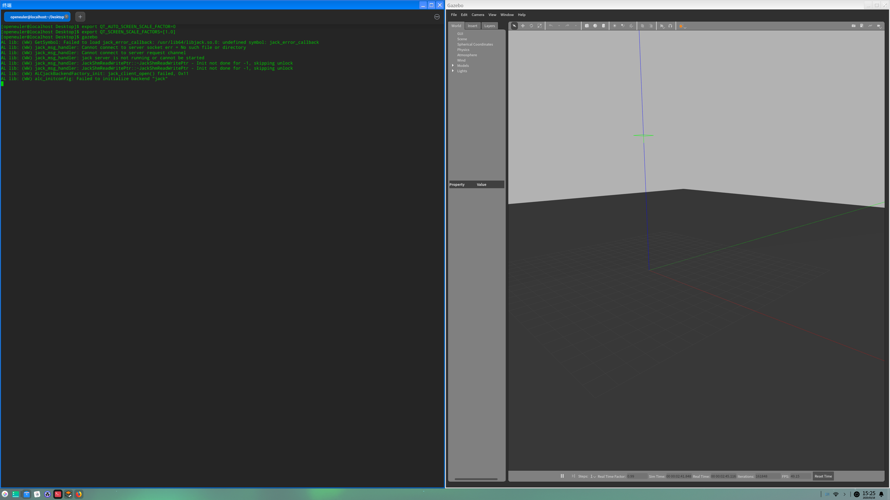
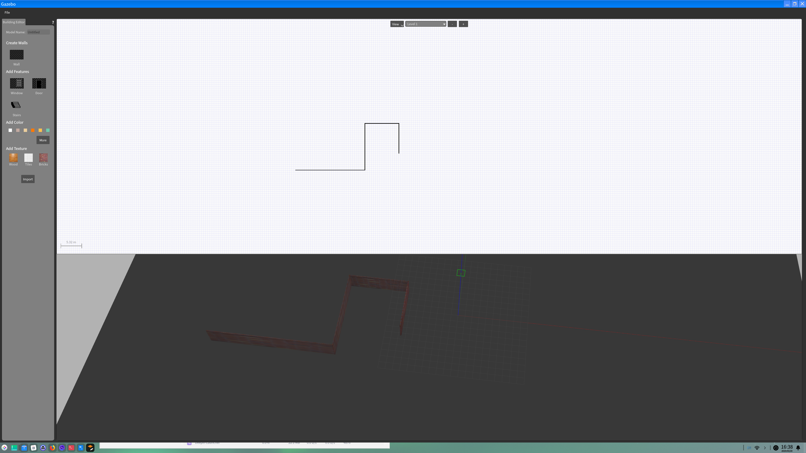
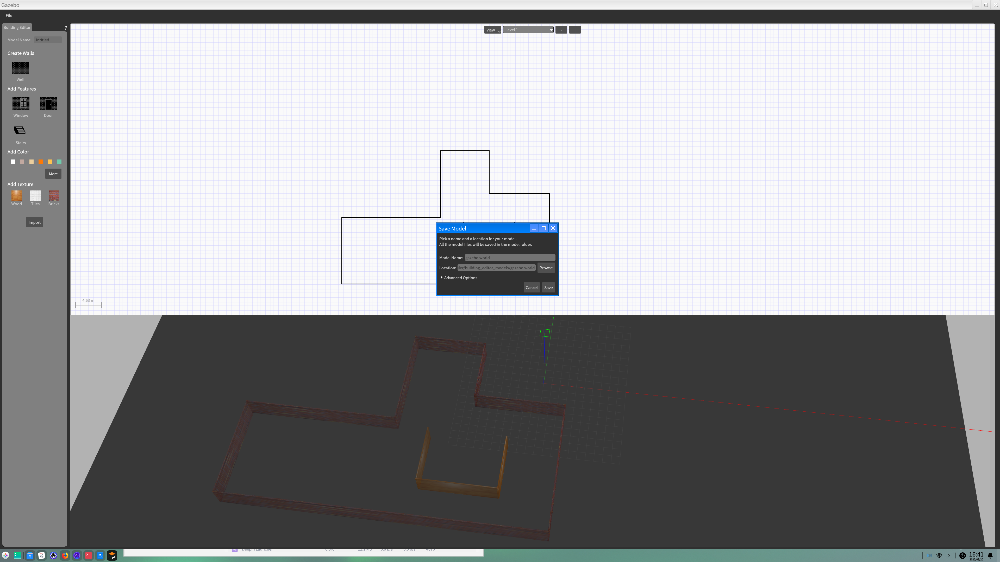
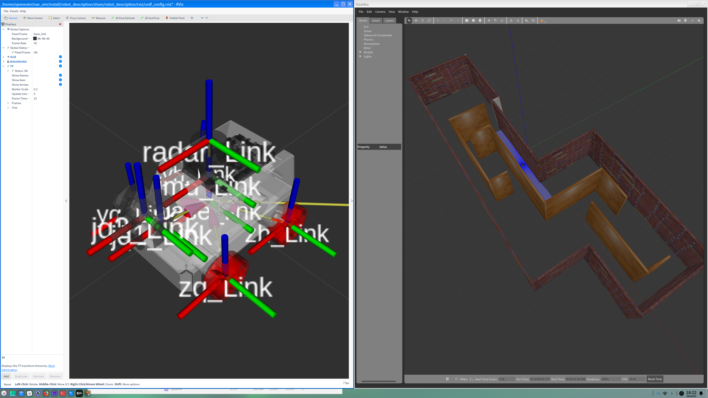

# OpenEuler 建图导航仿真

运行环境： 

+ OS ： OpenEuler 24.03(LTS)
+ CPU ： Intel(R) Core(TM) i5-7260U
+ Memory：8G

## Gazebo 下载与启动：

### Gazebo 源配置：

添加 `gazebo` 源 `vim /etc/yum.repos.d/gazebo.repo`：

```bash
[openEulerROS-humble-3rdparty]
name=openEulerROS-humble
baseurl=https://eulermaker.compass-ci.openeuler.openatom.cn/api/ems1/repositories/ROS-SIG-Multi-Version_ros-humble_openEuler-24.03-LTS-ROS-3rdparty/openEuler%3A24.03-LTS/x86_64 
enabled=1
gpgcheck=0
```

### 启动 gazebo：

Terminal 中输入指令： `gazebo`



> 若出现报错：
>
> ```bash
> gazebo: error while loading shared libraries: libhdf5.so.310: cannot open shared object file: No such file or directory
> ```
>
> 在/etc/ld.so.conf.d中添加文件`custom.conf`并刷新ld缓存
>
> ```bash
> echo "/usr/lib64/mpich/lib" > /etc/ld.so.conf.d/custom.conf
> ldconfig
> ```
>
> 图形界面显示不完全，打开终端输入：
>
> ```bash
> export QT_AUTO_SCREEN_SCALE_FACTOR=0
> export QT_SCREEN_SCALE_FACTORS=[1.0]
> ```


## Gazebo 场景搭建

启动 `Gazebo` 图形界面，点击 `Edit->Building Editor` 启动环境编辑界面，左侧选择墙体以及材质，根据需要构建运行环境地图：



构建结束后，将地图文件保存为 `.world` 文件




## 机器人模型发布

机器人模型仿真模型通过 `urdf` 模型发布，基本的模型搭建可以参考：

https://wiki.ros.org/urdf/XML/link
https://docs.ros.org/en/humble/Tutorials/Intermediate/URDF/URDF-Main.html

新建仿真包工作地址：

```
mkdir nav_sim_ws
```

下载仿真包：

```bash
cd nav_sim_ws
git clone git@github.com:Akana-kunama/nav2_sim.git
```

编译机器人模型发布包：

```bash
colcon build --packages-select robot_description
```

启动模型发布：

```bash
ros2 launch robot_description robot_display		
```




> 如遇到路径相关报错，将 `urdf` 文件中机器人模型的相关路径修改为绝对路径即可：
>
> ```xml
>  <mesh filename="package://robot_description/meshes/MicroROS/base_link.STL" />
> ```
>
> 修改为：
>
> ```xml
> <mesh filename="file//<path to package>/robot_description/meshes/MicroROS/base_link.STL" />
> ```


## Slam Tool Box 建图


## Navigation2 导航


## Reference

https://fishros.org/doc/nav2/concepts/index.html#

https://docs.nav2.org/search.html?q=Model&check_keywords=yes&area=default
